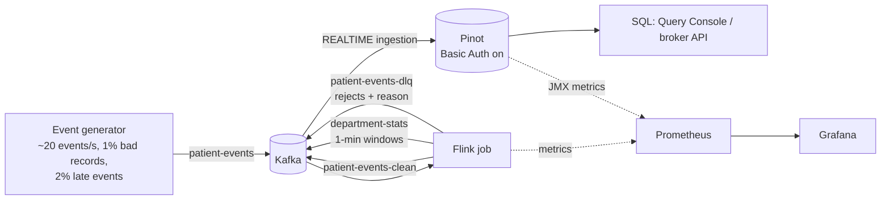
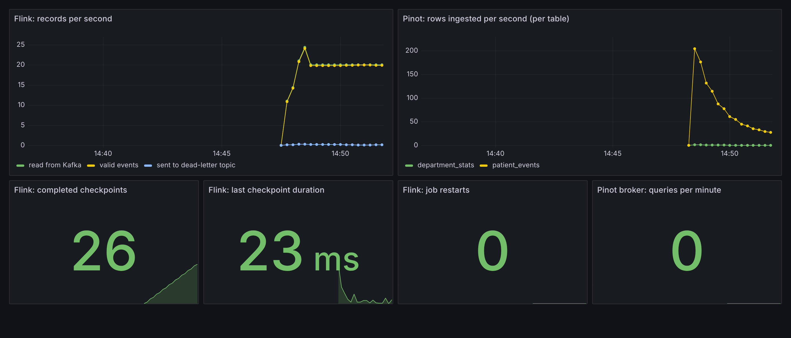

# Realtime Health Analytics

[](https://github.com/prajwal-jadhav01/realtime-health-analytics/actions/workflows/ci.yml)

A streaming analytics pipeline for hospital events. Synthetic admissions, vitals readings and discharges flow through **Kafka**, are validated and aggregated by **Apache Flink** (Java), and become queryable in **Apache Pinot** within seconds. **Basic Auth is turned on in Pinot**. Prometheus and Grafana track the health of the pipeline.

One command starts everything:

```bash
docker compose up -d --build
```

All data is randomly generated. No real patient data is used anywhere.

## Architecture



### What the Flink job does

1. **Parses and validates** every message. Truncated JSON, unknown event types and physically impossible vitals (heart rate 900) are not dropped silently. They go to a **dead-letter topic** with the reason attached, so someone can fix the source.
2. **Flags abnormal vitals** with simple, explainable thresholds: heart rate outside 50–120, SpO₂ below 92, systolic above 180, temperature of 39 °C or more. These are illustrative, not clinical guidance.
3. **Aggregates per department in 1-minute event-time windows**: event counts, admissions, discharges, abnormal readings, average heart rate and minimum SpO₂. The aggregation is incremental (`AggregateFunction`), so Flink stores one small accumulator per window instead of every event.
4. **Handles out-of-order data**: watermarks allow 10 s of lateness, and idle partitions don't stall event time.
5. **Checkpoints every 10 s**, so window state and Kafka offsets survive a crash.

### Why Pinot pulls from Kafka instead of Flink writing to Pinot

Pinot's REALTIME tables consume Kafka directly. This decouples the two systems: Pinot can be restarted, re-indexed or replayed from Kafka without touching the Flink job, and Flink never needs Pinot credentials.

The other common pattern is pushing **batch segments** from Flink into an OFFLINE table using Pinot's Flink connector. That path is where authentication breaks: the connector's sink doesn't pass credentials when it uploads segments, so turning on Pinot auth makes every Flink upload fail with `401 Unauthorized`. I hit this in production and opened a fix upstream: **[apache/pinot#20121](https://github.com/apache/pinot/pull/20121)** (in review). Once it ships in a Pinot release, this repo will add an OFFLINE backfill job that uses it.

### Pipeline health in Grafana



## Running it

Requirements: Docker with about 6 GB of memory available to it.

```bash
docker compose up -d --build   # first build takes a few minutes
./scripts/smoke-test.sh        # waits for data to reach Pinot and checks auth is enforced
```

| What | Where | Login |
|---|---|---|
| Pinot Query Console | http://localhost:9000 | `admin` / `adminpass` (or read-only `analyst` / `analystpass`) |
| Flink dashboard | http://localhost:8081 | – |
| Grafana | http://localhost:3000 | anonymous view, or `admin` / `admin` |
| Prometheus | http://localhost:9090 | – |

The credentials are demo values committed on purpose so the project runs out of the box. In a real deployment they come from a secret store.

Handy commands (see the `Makefile`): `make query`, `make dlq`, `make logs`, `make test`, `make down`.

### Example queries

Abnormal readings by department:

```sql
SELECT department,
       COUNT(*) AS readings,
       SUM(CASE WHEN abnormal THEN 1 ELSE 0 END) AS abnormal,
       AVG(heartRate) AS avg_hr
FROM patient_events
WHERE eventType = 'VITALS'
GROUP BY department
ORDER BY abnormal DESC
```

Sample result after a few minutes (the generator makes ICU patients sicker on purpose):

| department | readings | abnormal | avg_hr |
|---|---|---|---|
| icu | 4116 | 1037 | 95.8 |
| pediatrics | 4455 | 389 | 85.2 |
| cardiology | 4238 | 265 | 83.3 |

The last 10 minutes of department activity, from the pre-aggregated table:

```sql
SELECT department, windowStart, events, admissions, abnormalReadings, minSpo2
FROM department_stats
WHERE windowStart > ago('PT10M')
ORDER BY windowStart DESC, abnormalReadings DESC
```

A query without credentials is rejected:

```bash
$ curl -s -o /dev/null -w '%{http_code}\n' -H 'Content-Type: application/json' \
    -d '{"sql":"SELECT COUNT(*) FROM patient_events"}' http://localhost:8099/query/sql
401
```

## Auth setup in Pinot

All of it lives in [`pinot/conf`](pinot/conf):

- **Controller**: `BasicAuthAccessControlFactory` with an `admin` user and a read-only `analyst` user.
- **Broker**: the same users. `analyst` can only query the two health tables.
- **Server**: once the controller requires auth, the server must also send a token when it uploads or downloads segments, or ingestion silently stops. Every client that talks to the controller needs the same treatment, and that is exactly the gap the Flink connector had.

## Tests

- **Unit tests** (`make test`) run the real pipeline topology on a local Flink mini-cluster with in-memory input. They check window boundaries, aggregation results, abnormal flags and dead-letter routing.
- **End-to-end test** (`scripts/smoke-test.sh`, run in CI on every push) starts the whole stack, waits for rows to land in both Pinot tables, checks that an unauthenticated query gets `401`, and checks that impossible vitals never reached Pinot.

## Design decisions and trade-offs

- **At-least-once output.** Checkpoints restore state exactly once, but the Kafka sinks are at-least-once, so a crash can re-emit up to about 10 s of records. For dashboards that's acceptable. If exact counts mattered, I'd switch the sinks to `EXACTLY_ONCE` (Kafka transactions, with `read_committed` consumers in Pinot), or enable Pinot upserts keyed on `eventId`.
- **Late events** arriving more than 10 s late are left out of their window but are still stored in `patient_events`, so raw queries remain correct. A side output for late data would be the next step.
- **Keyed by patient in Kafka**, so one patient's events stay in order within a partition.
- **Inverted indexes** on `department`, `eventType` and `hospitalId` (the columns used in filters and group-bys), and a range index on the time column.

## What I'd change at 100x scale

- Several Pinot servers with replication, and segment tiering to deep storage (S3) for older data.
- Avro or Protobuf with a schema registry instead of JSON.
- RocksDB state backend with incremental checkpoints to object storage.
- Alerting on consumer lag and checkpoint failures, not only dashboards.

## Project layout

```
pipeline/                Flink job + event generator (Java 17, Maven)
  src/main/java/.../job        parsing, validation, windowing, Kafka wiring
  src/main/java/.../generator  synthetic event producer
  src/test/java/...            unit tests on a Flink mini-cluster
pinot/                   schemas, table configs, auth configs
monitoring/              Prometheus scrape config, Grafana dashboard
scripts/                 topic + table setup, end-to-end smoke test
```
